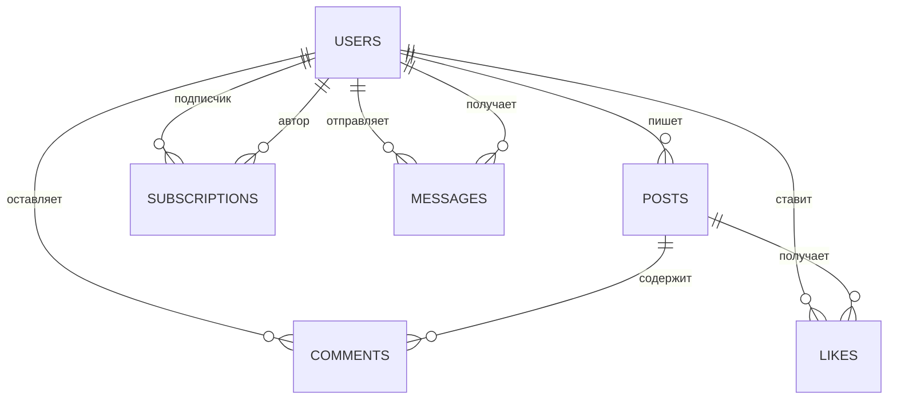

# Раздел 1. Анализ предметной области

## 1.1. Назначение приложения

«Круг» — мобильное приложение социальной сети для обмена публикациями, комментариями,
лайками и личными сообщениями. Приложение предназначено для автоматизации процессов общения
с мобильных устройств под управлением ОС Android: пользователь может вести ленту,
подписываться на интересных авторов, обсуждать записи, публиковать фотографии,
переписываться с другими пользователями и управлять профилем.

Цель проекта — предоставить автономный мобильный интерфейс социальной сети с локальным
хранением данных (SQLite), не требующий подключения к интернету и внешнему серверу.

## 1.2. Роли пользователей

| Роль | Возможности |
|------|-------------|
| **Гость** | Просмотр экрана входа и регистрация нового аккаунта. |
| **Пользователь** | Просмотр ленты и публикаций, поиск, лайки, комментарии, подписки, создание и удаление своих публикаций (в том числе с фото) и комментариев, личная переписка, редактирование профиля, смена темы. |
| **Администратор** | Все возможности пользователя + панель администратора: статистика, список всех пользователей, блокировка/разблокировка и удаление пользователей вместе с их контентом. |

## 1.3. Основные сущности

- **Пользователь (User)** — учётная запись: логин, хеш пароля, имя, описание, роль, признак блокировки.
- **Публикация (Post)** — запись в ленте: заголовок, текст, категория, необязательное фото, дата, автор.
- **Комментарий (Comment)** — сообщение пользователя под публикацией.
- **Лайк (Like)** — отметка «нравится», уникальная для пары «публикация + пользователь».
- **Подписка (Subscription)** — связь «подписчик → автор», определяет вкладку «Подписки».
- **Сообщение (Message)** — личное сообщение от одного пользователя другому: текст, дата, признак прочтения.
- **Диалог (Conversation)** — переписка текущего пользователя с собеседником: последнее сообщение, время, число непрочитанных.

## 1.4. Функциональные требования

1. Регистрация с проверкой уникальности логина и валидацией полей; вход с проверкой пароля и блокировки.
2. Главный экран с нижней навигацией: «Лента», «Поиск», «Создать», «Чаты», «Профиль».
3. Лента с тремя вкладками: все публикации, публикации подписок, популярные (по лайкам).
4. Экран деталей публикации: полный текст, фото, лайк, подписка на автора, комментарии, переход в личный чат.
5. Создание публикации с валидацией заголовка и текста, выбором категории и необязательным фото из галереи.
6. Редактирование профиля (имя, описание) и просмотр статистики (публикации, подписчики, лайки).
7. Поиск в реальном времени по публикациям, авторам и категориям.
8. Личные сообщения: список диалогов, переписка, отправка, прочтение, поиск собеседника, удаление переписки.
9. Панель администратора: статистика, блокировка и удаление пользователей.
10. Светлая и тёмная темы; сохранение сессии и выбора темы.

## 1.5. Схема базы данных

Используется SQLite, версия схемы 2. Внешние ключи включены (`onConfigure → setForeignKeyConstraintsEnabled(true)`),
все связи используют `ON DELETE CASCADE`, что обеспечивает целостность при удалении пользователя или публикации.
При обновлении с версии 1 данные пользователей сохраняются: добавляются таблица `messages` и колонка `posts.image_path`.

### users

| Колонка | Тип | Ограничения | Описание |
|---------|-----|-------------|----------|
| `_id` | INTEGER | PK AUTOINCREMENT | Идентификатор |
| `username` | TEXT | NOT NULL UNIQUE COLLATE NOCASE | Логин |
| `password_hash` | TEXT | NOT NULL | SHA-256 от соли, логина и пароля |
| `full_name` | TEXT | NOT NULL | Отображаемое имя |
| `bio` | TEXT | NOT NULL DEFAULT '' | Описание профиля |
| `role` | TEXT | NOT NULL DEFAULT 'user' | `user` или `admin` |
| `is_blocked` | INTEGER | NOT NULL DEFAULT 0 | 1 — аккаунт заблокирован |
| `created_at` | INTEGER | NOT NULL | Дата регистрации (мс) |

### posts

| Колонка | Тип | Ограничения |
|---------|-----|-------------|
| `_id` | INTEGER | PK AUTOINCREMENT |
| `user_id` | INTEGER | NOT NULL, FK → users(_id) ON DELETE CASCADE |
| `title` | TEXT | NOT NULL |
| `content` | TEXT | NOT NULL |
| `category` | TEXT | NOT NULL |
| `image_path` | TEXT | Путь к фото в приватной папке приложения, может быть NULL |
| `created_at` | INTEGER | NOT NULL |

Индексы: `idx_posts_created`, `idx_posts_user`.

### comments

| Колонка | Тип | Ограничения |
|---------|-----|-------------|
| `_id` | INTEGER | PK AUTOINCREMENT |
| `post_id` | INTEGER | NOT NULL, FK → posts(_id) ON DELETE CASCADE |
| `user_id` | INTEGER | NOT NULL, FK → users(_id) ON DELETE CASCADE |
| `text` | TEXT | NOT NULL |
| `created_at` | INTEGER | NOT NULL |

Индекс: `idx_comments_post`.

### likes

| Колонка | Тип | Ограничения |
|---------|-----|-------------|
| `_id` | INTEGER | PK AUTOINCREMENT |
| `post_id` | INTEGER | NOT NULL, FK → posts(_id) ON DELETE CASCADE |
| `user_id` | INTEGER | NOT NULL, FK → users(_id) ON DELETE CASCADE |
| `created_at` | INTEGER | NOT NULL |
| — | — | UNIQUE(post_id, user_id) |

Индекс: `idx_likes_post`.

### subscriptions

| Колонка | Тип | Ограничения |
|---------|-----|-------------|
| `_id` | INTEGER | PK AUTOINCREMENT |
| `follower_id` | INTEGER | NOT NULL, FK → users(_id) ON DELETE CASCADE |
| `following_id` | INTEGER | NOT NULL, FK → users(_id) ON DELETE CASCADE |
| `created_at` | INTEGER | NOT NULL |
| — | — | UNIQUE(follower_id, following_id) |

Индексы: `idx_subs_follower`, `idx_subs_following`.

### messages

| Колонка | Тип | Ограничения |
|---------|-----|-------------|
| `_id` | INTEGER | PK AUTOINCREMENT |
| `sender_id` | INTEGER | NOT NULL, FK → users(_id) ON DELETE CASCADE |
| `recipient_id` | INTEGER | NOT NULL, FK → users(_id) ON DELETE CASCADE |
| `text` | TEXT | NOT NULL |
| `is_read` | INTEGER | NOT NULL DEFAULT 0 (1 — прочитано получателем) |
| `created_at` | INTEGER | NOT NULL |

Индексы: `idx_messages_sender` (sender_id, recipient_id), `idx_messages_recipient` (recipient_id, is_read), `idx_messages_created`.

### ER-диаграмма



## 1.6. Архитектура приложения

Приложение построено по слоям:

```
UI (Activity / Fragment / Adapter)
        │  вызовы через колбэки
        ▼
Repository (UserRepository, PostRepository, CommentRepository, MessageRepository)
        │  SQL-запросы
        ▼
AppDatabase (SQLiteOpenHelper) → SQLite
```

- **UI** не содержит SQL и не работает с `Cursor` напрямую.
- **Repository** инкапсулирует запросы, возвращает готовые модели (`User`, `Post`, `Comment`, `Message`, `Conversation`).
- **AppExecutors** выполняет все операции с БД в пуле фоновых потоков (`ExecutorService`),
  результат доставляется в главный поток через `Handler`, поэтому UI обновляется безопасно.
- **CursorMapper** централизует преобразование строк `Cursor` в модели.
- **ImageStorage** копирует выбранное фото в приватную папку приложения и сжимает его,
  **ImageLoader** декодирует изображения в фоне и кэширует их в памяти (`LruCache`).

## 1.7. Обработка ошибок и валидация

- Пустые поля логина/пароля/заголовка/текста проверяются до записи в БД (`TextInputLayout.setError`,
  `EditText.setError` для комментария).
- Логин — минимум 3 символа, пароль — минимум 6, пароли должны совпадать.
- Уникальность логина проверяется запросом перед вставкой; СУБД дополнительно защищена ограничением `UNIQUE`.
- Пароли хранятся только в виде хеша SHA-256 с солью.
- Заблокированный пользователь не может войти, его публикации не показываются в ленте.
- Удаление публикаций и комментариев доступно автору и администратору и подтверждается диалогом.
- Сообщение не может быть пустым и длиннее 2000 символов; отправить сообщение самому себе нельзя.
- При удалении публикации её файл изображения удаляется из внутреннего хранилища.
